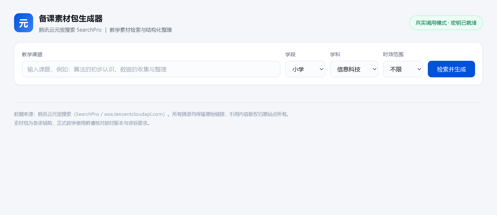
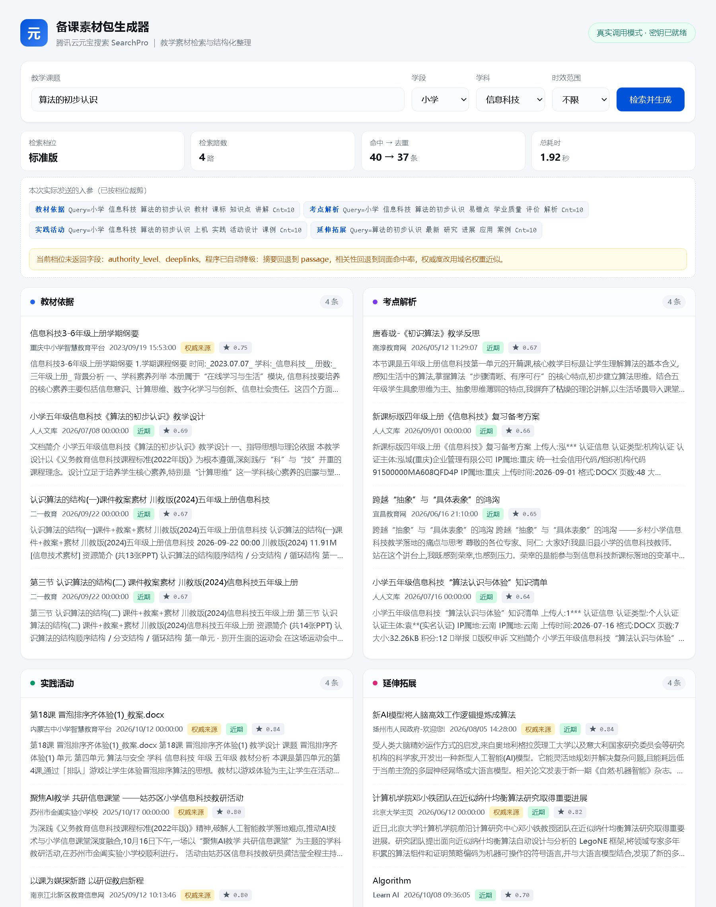
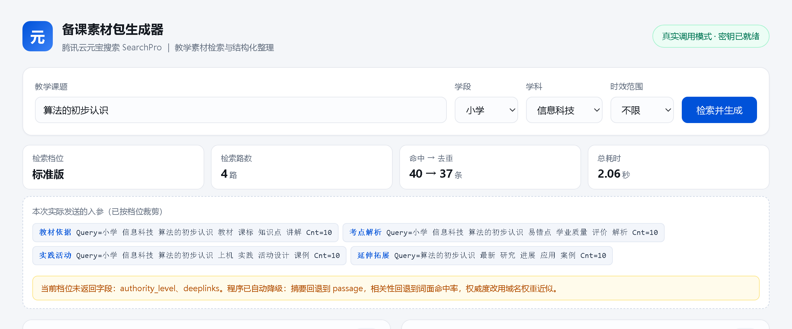

# 备课素材包生成器 · 使用与参赛指南

> CSDN「元宝搜索开发者征文大赛」参赛配套工具。纯 Python 标准库实现，零第三方依赖。

输入一个课题，自动拆成「教材依据 / 考点解析 / 实践活动 / 延伸拓展」四路检索，去重、打分、按板块呈现，一键导出带出处的 Markdown 素材包。**不需要 pip 安装任何东西**，`python app.py` 即可运行。

## 效果预览

首页（输入课题，默认小学 / 信息科技）：



检索结果（四栏卡片，每条都带站点、日期与原始链接）：



把降级这件事摊开给用户看——本次实际发送的入参、当前档位缺失的字段：



## 一、赛前准备：邀请码核销六步（未核销者必做）

1. 登录腾讯云 → 打开元宝搜索**活动专区**：https://console.cloud.tencent.com/wsapi/activity
2. 点【立即开通】
3. 按需选配置：**档位选标准版**（旗舰版仅企业可开通），**计费方式选「按量计费（后付费）」**，别买资源包（最低 5 万次 950 元，个人一年用不到 1200 次），右下角【立即开通】
4. 开通成功后【进入控制台】
5. 再次进入【活动专区】→【参与活动】
6. 填入邀请码 **4US3FK88** 提交核销 → 月免费额度 2000 → 6000 次

注意事项：
- 活动期 2026.10.10 – 11.30，过期核销无效，请尽快
- 核销一次性，多码不叠加
- 个人（TOC）额度仅限极速版 / 标准版
- 后付费是**先用后付、次日出账**，额度用尽会自动转扣费、不会自动停；建议在费用中心设一个 10 元预算提醒兜底。标准版 20 元/千次，一次生成素材包 4 次调用 ≈ 0.08 元

## 二、运行工具

1. 在腾讯云【访问管理 → API 密钥管理】新建密钥，得到 `SecretId` / `SecretKey`
2. 把 `config.example.json` 复制为 `config.json`，填入两个值
3. 双击运行或在目录里执行：

```bash
python app.py
```

浏览器会自动打开 http://127.0.0.1:8848 ，输入课题（如"算法的初步认识"）点【检索并生成】。
不填密钥也能打开，但属于演示数据，界面有黄色标注。

命令行版（可选）：

```bash
python yb_search.py 算法的初步认识 --stage 小学 --subject 信息科技 --tier standard -o 素材包.md
```

**单文件精简版**（`yuanbao_prep.py`，约 200 行，无网页层，适合贴进文章附录给读者复现）：

```bash
# 密钥同样读 config.json；也可用环境变量覆盖
python yuanbao_prep.py 算法的初步认识
```

## 三、截图指引（文章正文共 4 张，第 5 张可选）

| # | 截什么 | 怎么截 | 贴到文章哪 |
|---|---|---|---|
| 1 | 工具首页（输入态） | 起服务后不填课题，直接截首页 | 第一节末尾 |
| 2 | 终端真实调用 | `python yuanbao_prep.py 算法的初步认识`，截逐路打印的入参 | 第三节末尾 |
| 3 | 结果页四栏全貌 | 检索等结果出来后整页截 | 第五节 |
| 4 | 指标条 + "本次实际发送的入参" | 截页面上方指标卡、参数 chips 与黄色提示 | 第五节 |
| 5 | 导出的 Markdown（可选） | 打开 `导出示例-算法的初步认识.md` 截图 | 第六节 |

截图后把文章里的 `<!-- 【截图 N：...】 -->` 占位注释替换为图片即可（CSDN 编辑器直接拖图上传）。

## 四、发表与提交

1. CSDN 发布**原创**文章，标题格式：
   `【元宝搜索开发者征文大赛】零依赖接入元宝搜索：只用 Python 标准库手写签名，给备课做了一个素材包生成器`
   （标题前缀必须是这个，后半段可改）
2. 正文粘贴 `征文正文-元宝搜索.md` 内容（正文约 5800 字，不含代码，远超 1500 字要求）
3. 声明原创、插入 4 张截图（第 5 张可选）
4. 回报名表提交文章链接：https://marketing.csdn.net/questions/Q2610151510175844245

## 五、目录说明

```
yuanbao-contest/
├── yuanbao_prep.py      # 单文件精简版（文章附录 A，复制即跑）
├── app.py               # 本地服务（http.server，零依赖）
├── yb_search.py         # 核心：TC3 签名 / SearchPro / 档位裁剪 / 去重打分 / 导出
├── mock_data.py         # 演示模式样例数据
├── static/index.html    # 前端单页
├── config.example.json  # 密钥配置模板 → 复制为 config.json
├── 征文正文-元宝搜索.md   # CSDN 发文正文
└── 导出示例-算法的初步认识.md   # 真实运行导出的素材包示例
```

## 六、常见报错对照

| 报错 | 原因与处理 |
|---|---|
| AuthFailure / Signature… | 密钥不成对，或本机时间偏差超过 5 分钟 |
| InvalidParameter | 极速版传了 Mode/Cnt/Industry；本工具已自动裁剪，一般不会出现 |
| ResourceNotFound / Unavailable | 服务未开通或额度耗尽，回控制台确认 |
| RequestLimitExceeded | QPS 限流，降低频率重试 |
